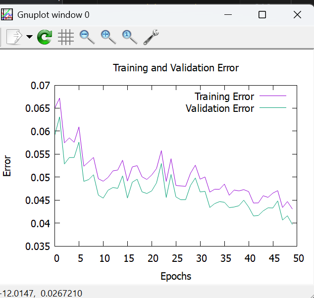

# Rapport d'Expérimentation – Projet de Pricing  

KANE El Hadji Abdoul Aziz
GRÉGOIRE Jean-Minh

### Fichier d'expérience : \Examples\TrainingConsole\pricing_expe.json
### Meilleur réseau sauvegardé : \Examples\TrainingConsole\pricing_learned.json

## 1. Introduction  
L'objectif de cette expérimentation est d'entraîner un réseau de neurones pour une tâche de **pricing**, en utilisant un jeu de données contenant :  
- 2000 échantillons pour l'entraînement  
- 8000 échantillons pour la validation  

---

## 2. Description de l'Architecture du Réseau  

Le réseau de neurones utilisé est un **réseau profond à propagation avant (feedforward)** :  

- **Entrée** : 7 caractéristiques (features)  
- **Couches cachées** :  
  - 128 neurones – Activation **LeakyReLU**  
  - 64 neurones – Activation **LeakyReLU**  
  - 32 neurones – Activation **LeakyReLU**  
- **Sortie** : 1 neurone – Activation **Identity** (fonction linéaire adaptée pour la régression)  
- **Batch Size** : 100  
- **Initialisation des poids** : **He Initialization**  

L’activation **LeakyReLU** est utilisée pour éviter le problème des neurones morts et améliorer la propagation du gradient.

### Optimisation et Ajustement des Gradients  
L’optimiseur **Adam (Adaptive Moment Estimation)** est utilisé avec :  
- Taux d’apprentissage (StepSize) : 0.001  
- Facteur de décroissance du premier moment (β1) : 0.9  
- Facteur de décroissance du second moment (β2) : 0.999  
- Facteur d’évitement de division par zéro : 1e-8  

Adam combine **Momentum** et **RMSProp**, ce qui permet une convergence rapide et stable.

### Régularisation  
Une régularisation **L2** a été appliquée pour limiter le surapprentissage.

---

## 3. Paramètres d'Entraînement  

| Paramètre                  | Valeur |
|----------------------------|--------|
| Nombre d’époques           | 1000   |
| Fonction de coût           | Quadratic (MSE) |
| Validation steps           | 20     |
| Fichier d'activation       | `pricing_activation.csv` |
| Fichier log d'erreur       | `pricing_error.csv` |
| Fichier final validation   | `pricing_final_validation.csv` |
| Utilisation de Gnuplot     | Oui |

La fonction de coût quadratique (**MSE**) est adaptée aux problèmes de **régression**.

### Gestion des Données  
- Données d’entraînement : `pricing_training.csv`  
- Données de validation : `pricing_validation.csv`  
- Initialisation du réseau : Oui (`"initialize": true`)  
- Sauvegarde du réseau entraîné : `pricing_learned.json`  

---

## 4. Entraînement et Évaluation  

### Processus d'entraînement  
1. Chargement des données d'entraînement et de validation.  
2. Initialisation du réseau avec He Initialization.  
3. Propagation avant pour calculer les sorties.  
4. Calcul de l’erreur avec MSE.  
5. Mise à jour des poids avec Adam.  
6. Validation toutes les 20 étapes.  
7. Sauvegarde du modèle final après 1000 époques.  

### Résultats attendus  
- Une diminution progressive de l'erreur de validation  
- Une convergence stable du modèle  
- Une bonne généralisation sur les données de validation  

### Évaluation post-entraînement  
- Analyse des erreurs (`pricing_error.csv`)  
- Visualisation avec Gnuplot  
- Distribution des activations (`pricing_activation.csv`)  



---

## 5. Conclusion et Améliorations Possibles  

L’architecture choisie est bien adaptée à la **régression**, avec un optimiseur robuste et une régularisation L2 pour limiter le surapprentissage.  

### Améliorations possibles :  
- Essayer d’autres fonctions de coût (Huber, log-cosh)  
- Explorer d’autres optimisateurs (Nadam, RAdam) 

------------------------------------------------------

# Neural Network Project

## General description

This is the skeleton of the Neural Network library you will develop. The main classes are provided
but must be completed. It gives the general architecture of the library. 

3 programs are also provided with the library : 
* And : this program is building a neural network (2 input, one output) with hard coded weights using the library API. This neural network with its weight is implementing a boolean and function. It computes (propagate method) the result for the four possible inputs and print them on the console. This program can be used to program and debug the ``propagate`` method on the ``NeuralNetwork`` and ``StandardLayer`` clases.
* AndFromFile : this program is also computing a boolean and function but the network is not hardcoded in Java using the API. Its loaded from a JSON description file. This description file might not contain the weight and bias values (useful when designing a neural network : it avoids putting manualy some intial values that will be modified when learning). This program can be used to implement and debug the ``fromDescription`` method of the ``NeuralNetwork`` class. A set of Java Classes (in the ``fr.ensimag.deep.serialization``) are provided. Theses classes can load the json file and create its Java Object representation (an instance of the ``NetworkDescription`` class). You must then create a ``NeuralNetwork`` instance using the API and corresponding to this JSON description. Once the loading works, you can implement and debug the  ``save`` method by uncommenting the last line of the AndFromFile class.
* TrainingConsole : once your library is able to load and save a network, you can the use the TrainingConsole program. This program can load a network, make operations on it (learning, validation, providing logs) and save the resulting network. All these operations are described in a json *experience* file.

Those three programs can be directly launched from vscode. The ``.vscode/launch.json`` is provided. The ``TrainingConsole`` can also be launched using the ``bin/training`` shell script. This shell script works if the jar of your project is in your ``$HOME/.m2`` repository. For this, you must compile your project using the following command
```shell
$ mvn install
```

## Json description of a neural network

```shell
$ cat and_network.json
{
  "InputSize" : 2,
  "BatchSize" : 2,
  "Initializer" : "He",
  "Layers" : [ {
    "Size" : 2,
    "ActivatorType" : "LeakyRelu",
    "GradientAdjustmentParameters" : {
      "Type" : "FixedLearningRate",
      "LearningRate" : 0.01
    },
    "Type" : "Standard",
    "Bias" : [  -0.5058334472697964, -0.000008328442276776526 ],
    "Weights" : [ [ 0.9311704048957733, -0.11429868803825326 ], [  0.9302798998973131, -0.9761685924220824] ]
  }, {
    "Size" : 1,
    "ActivatorType" : "LeakyRelu",
    "GradientAdjustmentParameters" : {
      "Type" : "FixedLearningRate",
      "LearningRate" : 0.01
    },
    "Type" : "Standard",
    "Bias" : [ -0.5116730749023093 ],
    "Weights" : [ [  1.1138955620990865 ], [ -0.1531486682736007 ] ]
  } ]
}
```

## Json decription of an experiment

```shell
$ cat and_expe.json
{
    "network description": "and_network.json",    
    "training data" : "and.csv",
    "validation data" : "and_valid.csv",
    "epochs" : 10000,
    "trained network" : "and_learned.json",
    "cost function" : "Quadratic",
    "initialize" : true,
    "learning log file" : "error.csv",
    "validation steps" : 20,
    "final validation" : "validation.csv",
    "activation file" : "activation.csv",
    "gnuplot" : true   
}
```

if ``gnuplot`` is set to ``true``, the program will display the cost function value on the training set and on the validation set at the end of the learning phase. These values are saved every ``validation steps`` steps of the main loop. They are saved in the ``learning log file``. If ``learning log file``is  absent or an empty file name is specified, the output will be on the console. 

The learning loop is executed ``epochs``. At each epoch, the training data are divided in mini batches. The mini batches size is specified in the ``BatchSize`` parameter of the network description. The ``network description`` file may or may not contain weigths and bias. Typically, when designing neural network, it is easier to create the json network file without the weights which are meaningless at this point. The serializer package provided will then randomly intialized the weights and bias (with no particular strategie like Xavier, He or Gaussian which might not be ideal...). Once loaded, the network can be intialized also if the ``initialize`` parameter of the experience file is set to true. The strategy specified in the ``Initializer`` field of the network description is used. If the network description contains weights and bias, they will be loaded. If ``initialize`` is set to false, then, the network will continue its training from this saved point. 

At the end of the learning log, the network will be saved (with its weights) in the file specified in the ``trained network`` field. The output value for all the ``validation data`` are computed and saved in the ``final validation`` csv file. To help debug you network, you can also save the activation of all the neurons (to check if there is a lot of dead neurons for instance) during the learning phase by specifying a file name in ``activation file``. If this parameter is not present or the filename is empty, the activation will not be logged.